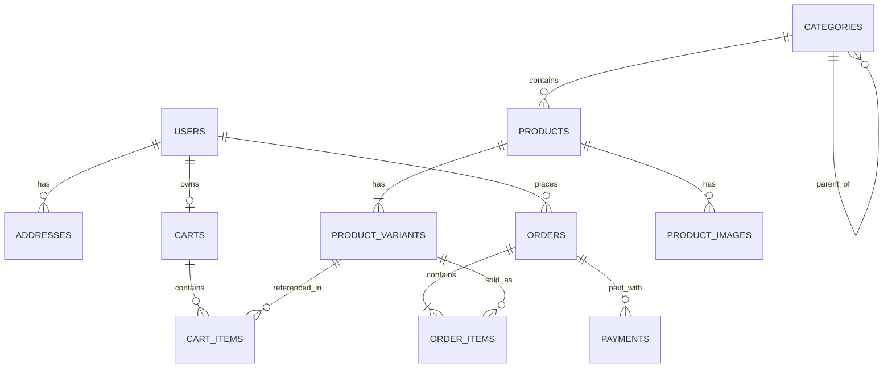

# Database Design Document & Schema Specification

**System:** Single-Merchant E-Commerce Platform (Golang + Gin)  
**Database Engine:** PostgreSQL 15+  
**Access Layer:** Raw SQL compiled type-safely via `sqlc` with `pgx/v5`  

---

## 1. Entity-Relationship Overview



---

## 2. Table Specifications & SQL DDL

### 2.1 Table: `users`
Registered customers and store administrators.

```sql
CREATE TABLE users (
    id BIGSERIAL PRIMARY KEY,
    email VARCHAR(255) UNIQUE NOT NULL,
    password_hash VARCHAR(255) NOT NULL,
    full_name VARCHAR(150) NOT NULL,
    role VARCHAR(30) NOT NULL DEFAULT 'customer', -- 'customer', 'admin'
    phone_number VARCHAR(30),
    is_active BOOLEAN NOT NULL DEFAULT TRUE,
    created_at TIMESTAMPTZ NOT NULL DEFAULT CURRENT_TIMESTAMP,
    updated_at TIMESTAMPTZ NOT NULL DEFAULT CURRENT_TIMESTAMP
);

CREATE INDEX idx_users_email ON users(email);
```

---

### 2.2 Table: `addresses`
Saved customer delivery addresses (for registered users).

```sql
CREATE TABLE addresses (
    id BIGSERIAL PRIMARY KEY,
    user_id BIGINT NOT NULL REFERENCES users(id) ON DELETE CASCADE,
    recipient_name VARCHAR(150) NOT NULL,
    phone VARCHAR(30) NOT NULL,
    street_line1 VARCHAR(255) NOT NULL,
    street_line2 VARCHAR(255),
    city VARCHAR(100) NOT NULL,
    state VARCHAR(100) NOT NULL,
    postal_code VARCHAR(20) NOT NULL,
    country VARCHAR(2) NOT NULL DEFAULT 'US',
    is_default BOOLEAN NOT NULL DEFAULT FALSE,
    created_at TIMESTAMPTZ NOT NULL DEFAULT CURRENT_TIMESTAMP
);

CREATE INDEX idx_addresses_user ON addresses(user_id);
```

---

### 2.3 Table: `categories`
Hierarchical product categorization.

```sql
CREATE TABLE categories (
    id BIGSERIAL PRIMARY KEY,
    parent_id BIGINT REFERENCES categories(id) ON DELETE SET NULL,
    name VARCHAR(100) NOT NULL,
    slug VARCHAR(120) UNIQUE NOT NULL,
    description TEXT,
    image_url VARCHAR(500),
    created_at TIMESTAMPTZ NOT NULL DEFAULT CURRENT_TIMESTAMP
);

CREATE INDEX idx_categories_slug ON categories(slug);
CREATE INDEX idx_categories_parent ON categories(parent_id);
```

---

### 2.4 Table: `products`
Physical product catalog.

```sql
CREATE TABLE products (
    id BIGSERIAL PRIMARY KEY,
    category_id BIGINT NOT NULL REFERENCES categories(id) ON DELETE RESTRICT,
    title VARCHAR(255) NOT NULL,
    slug VARCHAR(280) UNIQUE NOT NULL,
    description TEXT NOT NULL,
    base_price NUMERIC(10, 2) NOT NULL CHECK (base_price >= 0),
    status VARCHAR(20) NOT NULL DEFAULT 'published', -- 'draft', 'published', 'archived'
    created_at TIMESTAMPTZ NOT NULL DEFAULT CURRENT_TIMESTAMP,
    updated_at TIMESTAMPTZ NOT NULL DEFAULT CURRENT_TIMESTAMP
);

CREATE INDEX idx_products_category ON products(category_id);
CREATE INDEX idx_products_slug ON products(slug);
CREATE INDEX idx_products_status ON products(status);
```

---

### 2.5 Table: `product_variants`
Specific SKUs, physical properties (weight for shipping), attributes, and atomic stock counts.

```sql
CREATE TABLE product_variants (
    id BIGSERIAL PRIMARY KEY,
    product_id BIGINT NOT NULL REFERENCES products(id) ON DELETE CASCADE,
    sku VARCHAR(100) UNIQUE NOT NULL,
    name VARCHAR(150) NOT NULL, -- e.g. "Size: L, Color: Navy"
    price_override NUMERIC(10, 2) CHECK (price_override >= 0),
    stock_quantity INT NOT NULL DEFAULT 0 CHECK (stock_quantity >= 0),
    weight_grams INT DEFAULT 0, -- Used for physical shipping rates
    attributes JSONB NOT NULL DEFAULT '{}'::jsonb, -- e.g. {"size": "L", "color": "Navy"}
    created_at TIMESTAMPTZ NOT NULL DEFAULT CURRENT_TIMESTAMP,
    updated_at TIMESTAMPTZ NOT NULL DEFAULT CURRENT_TIMESTAMP
);

CREATE INDEX idx_variants_product ON product_variants(product_id);
CREATE INDEX idx_variants_sku ON product_variants(sku);
```

---

### 2.6 Table: `product_images`
Product media gallery.

```sql
CREATE TABLE product_images (
    id BIGSERIAL PRIMARY KEY,
    product_id BIGINT NOT NULL REFERENCES products(id) ON DELETE CASCADE,
    url VARCHAR(500) NOT NULL,
    alt_text VARCHAR(255),
    sort_order INT NOT NULL DEFAULT 0
);

CREATE INDEX idx_product_images_product ON product_images(product_id);
```

---

### 2.7 Table: `carts` & `cart_items`
Supports both guest shoppers and authenticated accounts with cart merging.

```sql
CREATE TABLE carts (
    id UUID PRIMARY KEY,
    user_id BIGINT REFERENCES users(id) ON DELETE CASCADE, -- NULL for guest carts
    guest_token VARCHAR(100), -- Client cookie or session UUID
    created_at TIMESTAMPTZ NOT NULL DEFAULT CURRENT_TIMESTAMP,
    updated_at TIMESTAMPTZ NOT NULL DEFAULT CURRENT_TIMESTAMP
);

CREATE TABLE cart_items (
    id BIGSERIAL PRIMARY KEY,
    cart_id UUID NOT NULL REFERENCES carts(id) ON DELETE CASCADE,
    variant_id BIGINT NOT NULL REFERENCES product_variants(id) ON DELETE CASCADE,
    quantity INT NOT NULL CHECK (quantity > 0),
    created_at TIMESTAMPTZ NOT NULL DEFAULT CURRENT_TIMESTAMP,
    CONSTRAINT uq_cart_variant UNIQUE (cart_id, variant_id)
);

CREATE INDEX idx_cart_items_cart ON cart_items(cart_id);
```

---

### 2.8 Table: `orders` & `order_items`
Stores orders for both authenticated customers and guests, holding address snapshots and shipment tracking.

```sql
CREATE TABLE orders (
    id BIGSERIAL PRIMARY KEY,
    order_number VARCHAR(36) UNIQUE NOT NULL, -- e.g. "ORD-2026-X89J"
    user_id BIGINT REFERENCES users(id) ON DELETE SET NULL, -- NULL for guest checkout
    customer_email VARCHAR(255) NOT NULL, -- Email address for order notifications
    customer_name VARCHAR(150) NOT NULL,
    customer_phone VARCHAR(30) NOT NULL,
    status VARCHAR(30) NOT NULL DEFAULT 'PENDING_PAYMENT',
    -- Status values: 'PENDING_PAYMENT', 'PAID', 'PROCESSING', 'SHIPPED', 'DELIVERED', 'CANCELLED'
    
    subtotal NUMERIC(10, 2) NOT NULL,
    shipping_fee NUMERIC(10, 2) NOT NULL DEFAULT 0.00,
    tax_amount NUMERIC(10, 2) NOT NULL DEFAULT 0.00,
    total_amount NUMERIC(10, 2) NOT NULL,
    
    -- Address snapshot prevents historical distortion if user updates their profile later
    shipping_address_snapshot JSONB NOT NULL,
    
    -- Fulfillment tracking info for physical delivery
    shipping_carrier VARCHAR(100), -- e.g. "FedEx", "DHL", "UPS"
    tracking_number VARCHAR(100),
    shipped_at TIMESTAMPTZ,
    delivered_at TIMESTAMPTZ,
    
    created_at TIMESTAMPTZ NOT NULL DEFAULT CURRENT_TIMESTAMP,
    updated_at TIMESTAMPTZ NOT NULL DEFAULT CURRENT_TIMESTAMP
);

CREATE TABLE order_items (
    id BIGSERIAL PRIMARY KEY,
    order_id BIGINT NOT NULL REFERENCES orders(id) ON DELETE CASCADE,
    variant_id BIGINT NOT NULL REFERENCES product_variants(id) ON DELETE RESTRICT,
    product_title VARCHAR(255) NOT NULL,
    variant_name VARCHAR(150) NOT NULL,
    unit_price NUMERIC(10, 2) NOT NULL,
    quantity INT NOT NULL CHECK (quantity > 0),
    line_total NUMERIC(10, 2) NOT NULL
);

CREATE INDEX idx_orders_user ON orders(user_id);
CREATE INDEX idx_orders_email ON orders(customer_email);
CREATE INDEX idx_orders_status ON orders(status);
CREATE INDEX idx_orders_created_at ON orders(created_at DESC);
CREATE INDEX idx_order_items_order ON order_items(order_id);
```

---

### 2.9 Table: `payments`
Tracks transactions and webhook receipts.

```sql
CREATE TABLE payments (
    id BIGSERIAL PRIMARY KEY,
    order_id BIGINT NOT NULL REFERENCES orders(id) ON DELETE CASCADE,
    gateway VARCHAR(50) NOT NULL, -- 'stripe', 'razorpay', 'mock'
    gateway_transaction_id VARCHAR(255) UNIQUE,
    amount NUMERIC(10, 2) NOT NULL,
    currency VARCHAR(3) NOT NULL DEFAULT 'USD',
    status VARCHAR(30) NOT NULL, -- 'PENDING', 'SUCCEEDED', 'FAILED', 'REFUNDED'
    metadata JSONB DEFAULT '{}'::jsonb,
    created_at TIMESTAMPTZ NOT NULL DEFAULT CURRENT_TIMESTAMP
);

CREATE INDEX idx_payments_order ON payments(order_id);
CREATE INDEX idx_payments_gateway_tx ON payments(gateway_transaction_id);
```

---

## 3. High-Concurrency Transaction Strategy (`sqlc` Queries)

To ensure zero overselling during checkout:
```sql
-- name: DeductStockForCheckout :execresult
UPDATE product_variants
SET stock_quantity = stock_quantity - $2,
    updated_at = CURRENT_TIMESTAMP
WHERE id = $1 AND stock_quantity >= $2;
```
If the rows affected is 0, the transaction rolls back immediately with an `INSUFFICIENT_STOCK` error.
